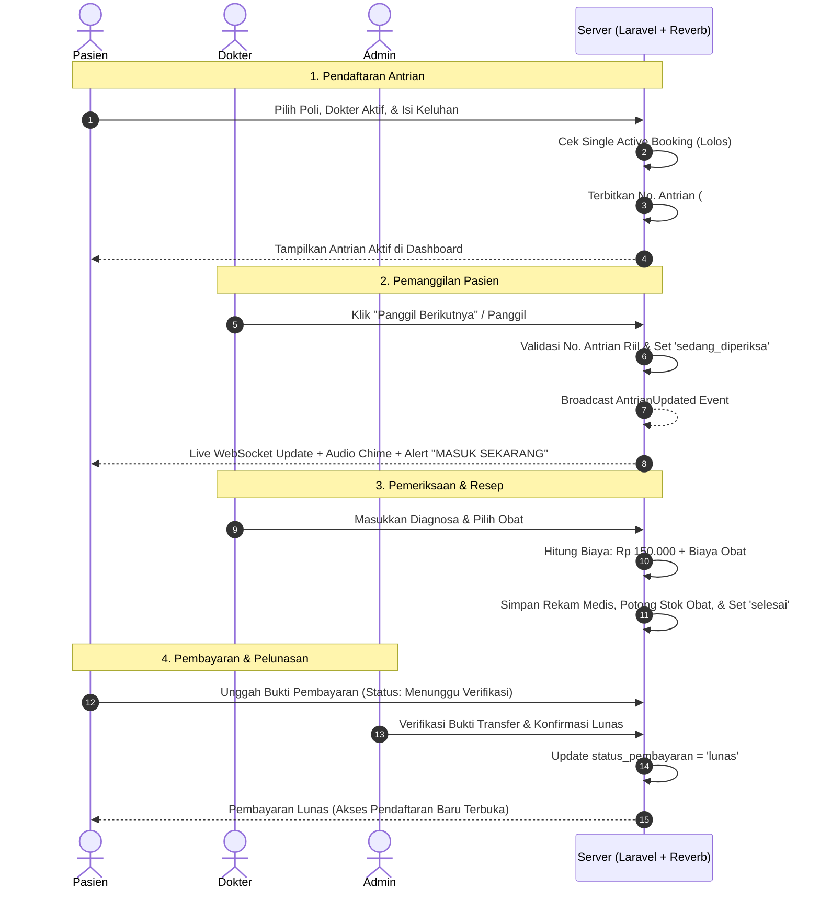

# 🏥 Sistem Informasi Poliklinik & Antrian Real-Time (Poliklinik App v2)

[](https://laravel.com)
[](https://php.net)
[](https://tailwindcss.com)
[](https://daisyui.com)
[](https://reverb.laravel.com)
[](https://mysql.com)

Aplikasi web terpadu untuk digitalisasi operasional rawat jalan poliklinik, mengintegrasikan sistem pendaftaran pasien, pelacakan antrian *real-time* berbasis WebSocket, pencatatan rekam medis & resep obat multi-item dokter, hingga verifikasi kasir/pembayaran digital.

---

## 📑 Daftar Isi

- [Arsitektur & Tech Stack](#-arsitektur--tech-stack)
- [Fitur Utama & Penjelasan Kode](#-fitur-utama--penjelasan-kode)
  - [1. Modul Pasien](#1-modul-pasien)
  - [2. Modul Dokter](#2-modul-dokter)
  - [3. Modul Administrator & Kasir](#3-modul-administrator--kasir)
- [Logika Bisnis Khusus (Edge Cases)](#-logika-bisnis-khusus-edge-cases)
- [Alur Kerja Sistem (Workflow)](#-alur-kerja-sistem-workflow)
- [Skema Basis Data](#-skema-basis-data)
- [Struktur Direktori](#-struktur-direktori)
- [Panduan Instalasi & Menjalankan](#-panduan-instalasi--menjalankan)
- [Akun Demo Pengujian](#-akun-demo-pengujian)

---

## 🛠 Arsitektur & Tech Stack

```
┌─────────────────────────────────────────────────────────────┐
│                       Frontend Layer                        │
│   Tailwind CSS v4 • DaisyUI v5 • FontAwesome 7 • Alpine.js  │
│          Native Web Audio API (Chime Synthesizer)           │
└──────────────┬──────────────────────────────▲───────────────┘
               │ HTTP Requests                │ WebSocket Events
               ▼                              │
┌─────────────────────────────────────────────┴───────────────┐
│                    Backend Layer (Laravel 13)               │
│   Controllers • Form Requests • Middleware (Role Check)     │
│       ShouldBroadcastNow Events • Eloquent ORM              │
└──────────────┬──────────────────────────────▲───────────────┘
               │ Queries / Mutations          │ Pusher/Reverb Sync
               ▼                              │
┌──────────────────────────────┐ ┌────────────────────────────┐
│   Database Layer (MySQL)     │ │ WebSocket Engine           │
│   InnoDB Relational Schema   │ │ Laravel Reverb Server      │
└──────────────────────────────┘ └────────────────────────────┘
```

---

## 🚀 Fitur Utama & Penjelasan Kode

### 1. Modul Pasien

#### A. Registrasi Mandiri & Pembuatan No. RM Otomatis
* **Penjelasan Kode**: Pasien mendaftar mandiri via `app/Http/Controllers/AuthController.php` method `register()`.
* **Logika No. RM**: Nomor Rekam Medis (No. RM) dibuat otomatis berbasis format periode pendaftaran `YYYYMM-XXX` (contoh: `202610-001`):
  ```php
  $lastId = (User::where('role', 'pasien')->max('id') ?? 0) + 1;
  $no_rm = date('Ym') . '-' . str_pad($lastId, 3, '0', STR_PAD_LEFT);
  ```

#### B. Pendaftaran Poli & Pencegahan *Double-Booking*
* **Penjelasan Kode**: `app/Http/Controllers/Pasien/DaftarPoliController.php`.
* Pasien memilih jadwal dokter aktif dan mengisi keluhan awal.
* **Aturan Single Active Registration**: Pasien yang memiliki antrian berstatus `menunggu`, `sedang_diperiksa`, atau sudah diperiksa namun **pembayarannya belum lunas** dilarang mendaftar ke poli lain.
  ```php
  // app/Models/DaftarPoli.php
  public function scopeActive($query) {
      return $query->where(function ($q) {
          $q->where('status_periksa', '!=', 'selesai')
            ->orWhereDoesntHave('periksa')
            ->orWhereHas('periksa', fn($sub) => $sub->where('status_pembayaran', '!=', 'lunas'));
      });
  }
  ```

#### C. Dashboard Antrian Real-Time & Chime Notifikasi
* **Penjelasan Kode**: `resources/views/pasien/dashboard.blade.php`.
* **WebSocket Listener**: Mendengarkan siaran `AntrianUpdated` via Laravel Echo pada channel `antrian-channel`.
* **Fallback Polling**: Menjalankan pengecekan setiap 5 detik ke `/api/antrian-status` via `app/Http/Controllers/AntrianLiveController.php` jika WebSocket terputus.
* **Hospital Chime (Web Audio API)**: Bunyi lonceng panggilan medis (*ding-dong* 587Hz ke 880Hz) disintesis secara dinamis di browser tanpa ketergantungan aset audio eksternal.

#### D. Portal Pembayaran & Upload Bukti Transfer
* **Penjelasan Kode**: `app/Http/Controllers/Pasien/PembayaranController.php`.
* Pasien memeriksa rincian biaya: Jasa pemeriksaan (Rp 150.000) + rincian harga obat.
* Mengunggah bukti pembayaran format gambar (JPG/PNG/WEBP, maks 2MB) ke storage disk publik dan mengubah status menjadi `menunggu_verifikasi`.
* Mengirimkan database notification ke dokter pemeriksa (`PembayaranDibuatNotification`).

---

### 2. Modul Dokter

#### A. Manajemen Jadwal Praktik
* **Penjelasan Kode**: `app/Http/Controllers/Dokter/JadwalPeriksaController.php`.
* Dokter mengatur jadwal operasional (Hari, Jam Mulai, Jam Selesai).
* Dilengkapi validasi waktu selesai wajib setelah waktu mulai (`after:jam_mulai`).

#### B. Dashboard Pelayanan & *List-Driven Patient Calling*
* **Penjelasan Kode**: `app/Http/Controllers/Dokter/PeriksaPasienController.php` method `callNumber()`.
* **Pencegahan Ghost Calling**: Tombol pemanggilan terikat langsung ke daftar pasien yang valid di database. Dokter dicegah memanggil nomor antrian yang belum terdaftar.
* **Auto-Update Status**: Saat nomor dipanggil, sistem secara otomatis mengubah status antrian pasien dari `'menunggu'` menjadi `'sedang_diperiksa'`.
* **Broadcasting Real-time**: Perubahan nomor antrian disiarkan seketika melalui event `App\Events\AntrianUpdated`:
  ```php
  $jadwal->update(['antrian_sekarang' => $noAntrian]);
  event(new AntrianUpdated($jadwal));
  ```

#### C. Pemeriksaan Medis & Peresepan Obat Dinamis
* **Penjelasan Kode**: `app/Http/Controllers/Dokter/PeriksaPasienController.php` method `store()`.
* **Kalkulasi Biaya Otomatis**:
  $$\text{Total Biaya} = \text{Biaya Jasa Dokter (Rp 150.000)} + \sum (\text{Harga Obat yang Dipilih})$$
* **Database Transaction Atomik**:
  - Menyimpan data pemeriksaan ke tabel `periksa`.
  - Menyimpan daftar obat ke tabel relasi `detail_periksa`.
  - Mengurangi stok obat di katalog (`stok - 1`).
  - Mengubah status pendaftaran pasien menjadi `'selesai'`.

#### D. Riwayat Pasien & Rekam Medis
* **Penjelasan Kode**: `app/Http/Controllers/Dokter/RiwayatPasienController.php`.
* Menampilkan catatan diagnosa, tanggal periksa, dan riwayat obat pasien yang pernah ditangani.
* Fitur ekspor riwayat pemeriksaan ke spreadsheet.

---

### 3. Modul Administrator & Kasir

#### A. Dashboard Monitoring & Verifikasi Cepat
* **Penjelasan Kode**: `resources/views/admin/dashboard.blade.php`.
* Metrik KPI: Total Dokter, Total Pasien, Poli Aktif, Pendapatan Lunas.
* Alert verifikasi pembayaran berprioritas tinggi jika terdapat transaksi berstatus `menunggu_verifikasi`.

#### B. Pengelolaan Data Master (CRUD)
* **Master Poli**: `app/Http/Controllers/Admin/AdminPoliController.php`.
* **Master Dokter**: `app/Http/Controllers/Admin/DokterController.php` (Pengikatan poli, kredensial akun, NIP/KTP, No HP).
* **Master Pasien**: `app/Http/Controllers/Admin/PasienController.php` (Manajemen No. RM & profil pasien).
* **Master Obat**: `app/Http/Controllers/Admin/ObatController.php` (Nama obat, kemasan, harga, dan manajemen stok).

#### C. Kasir & Verifikasi Pembayaran
* **Penjelasan Kode**: `app/Http/Controllers/Admin/VerifikasiPembayaranController.php`.
* Memeriksa kesesuaian bukti transfer pasien.
* Mengonfirmasi pelunasan tagihan (`status_pembayaran = 'lunas'`) dan mencatat `tgl_bayar`.
* Mengirimkan notifikasi verifikasi ke akun pasien (`PembayaranDiverifikasiNotification`).

---

## 🔒 Logika Bisnis Khusus (Edge Cases)

1. **Anti-Ghost Queue Calling**:
   Dokter tidak dapat menaikkan penghitung antrian jika tidak ada pasien berikutnya dalam antrian jadwal tersebut. Jika seluruh antrian selesai, antarmuka beralih ke status **"Semua Antrian Selesai"**.
2. **Kunci Pendaftaran Tunggal (Anti Double-Booking)**:
   Pasien dilarang mendaftar ke dokter atau poliklinik lain selama sesi antrian saat ini belum diselesaikan dan dilunasi.
3. **Sinkronisasi Otomatis Status Pasien**:
   Bila dokter memanggil nomor tertentu atau membuka form periksa pasien tersebut, sistem langsung mengupdate status antrian pasien menjadi `'sedang_diperiksa'` di database dan memancarkannya ke dashboard pasien.

---

## 🔄 Alur Kerja Sistem (Workflow)



---

## 🗄 Skema Basis Data

| Tabel | Keterangan & Relasi Utama |
| :--- | :--- |
| `users` | Akun pengguna seluruh peran (`role`: `admin`, `dokter`, `pasien`), No. KTP, No. HP, No. RM, dan foreign key `id_poli` (khusus dokter). |
| `poli` | Data poliklinik spesialisasi (`nama_poli`, `keterangan`). |
| `jadwal_periksa` | Sesi jadwal praktik dokter (`id_dokter`, `hari`, `jam_mulai`, `jam_selesai`, `status`, `antrian_sekarang`). |
| `daftar_poli` | Transaksi pendaftaran antrian (`id_pasien`, `id_jadwal`, `keluhan`, `no_antrian`, `status_periksa`). |
| `periksa` | Hasil rekam medis & transaksi pembayaran (`id_daftar_poli`, `tgl_periksa`, `catatan`, `biaya_periksa`, `status_pembayaran`, `bukti_pembayaran`). |
| `obat` | Katalog farmasi (`nama_obat`, `kemasan`, `harga`, `stok`). |
| `detail_periksa` | Tabel pivot peresepan obat (`id_periksa`, `id_obat`). |
| `notifications` | Notifikasi database transaksi pembayaran antar-pengguna. |

---

## 📁 Struktur Direktori

```
d:\bengkel-koding
├── app/
│   ├── Events/
│   │   └── AntrianUpdated.php              # Event broadcasting antrian real-time
│   ├── Http/
│   │   ├── Controllers/
│   │   │   ├── Admin/                      # Controller kelola master data & kasir
│   │   │   ├── Dokter/                     # Controller jadwal, periksa, & riwayat
│   │   │   ├── Pasien/                     # Controller antrian, pendaftaran, & bayar
│   │   │   ├── AntrianLiveController.php   # API endpoint status polling antrian
│   │   │   ├── AuthController.php          # Login, Register pasien (Auto No. RM)
│   │   │   └── ProfileController.php       # Profil & ganti password
│   │   └── Middleware/
│   │       └── RoleMiddleware.php          # Otorisasi role:admin, dokter, pasien
│   ├── Models/                             # Eloquent Models (User, Poli, Periksa, dll.)
│   ├── Notifications/                      # Database notifications bukti bayar & verifikasi
│   └── Services/
│       └── ExcelExportService.php          # Utilitas ekspor data tabular
├── database/
│   ├── migrations/                         # Skema tabel aplikasi
│   └── seeders/                            # Seeder data pengguna, poli, & obat awal
├── resources/
│   ├── css/app.css                         # Tailwind CSS v4 source
│   ├── js/                                 # Entrypoint JS & Laravel Echo setup
│   └── views/
│       ├── admin/                          # View dashboard & master data admin
│       ├── dokter/                         # View dashboard & ruang periksa dokter
│       ├── pasien/                         # View dashboard antrian & pembayaran pasien
│       ├── components/                     # Blade components (badge, layouts, partials)
│       └── auth/                           # Halaman login & register
└── routes/
    ├── channels.php                        # Definisi channel authorization WebSocket
    └── web.php                             # Routing web terstruktur berbasis role
```

---

## 💻 Panduan Instalasi & Menjalankan

### Prasyarat Sistem
* PHP >= 8.3
* Composer
* Node.js & NPM
* MySQL >= 8.0

### Langkah Instalasi

1. **Clone Repository**:
   ```bash
   git clone https://github.com/VickySetiawan19/bengkod-poli.git
   cd bengkod-poli
   ```

2. **Instal Dependensi PHP & Frontend**:
   ```bash
   composer install
   npm install
   ```

3. **Konfigurasi Environment**:
   Salin file `.env.example` ke `.env` dan sesuaikan kredensial basis data Anda:
   ```bash
   cp .env.example .env
   php artisan key:generate
   ```

   Pastikan konfigurasi broadcast menggunakan Reverb:
   ```env
   BROADCAST_CONNECTION=reverb
   QUEUE_CONNECTION=sync

   REVERB_APP_ID=bengkod
   REVERB_APP_KEY=bengkod-key
   REVERB_APP_SECRET=bengkod-secret
   REVERB_HOST="localhost"
   REVERB_PORT=8080
   REVERB_SCHEME=http

   VITE_REVERB_APP_KEY="${REVERB_APP_KEY}"
   VITE_REVERB_HOST="${REVERB_HOST}"
   VITE_REVERB_PORT="${REVERB_PORT}"
   VITE_REVERB_SCHEME="${REVERB_SCHEME}"
   ```

4. **Migrasi Basis Data & Seeders**:
   ```bash
   php artisan migrate:fresh --seed
   ```

5. **Kompilasi Aset Frontend**:
   ```bash
   npm run build
   ```

6. **Menjalankan Server**:
   Jalankan server WebSocket Reverb pada satu terminal:
   ```bash
   php artisan reverb:start
   ```
   Jalankan server web Laravel pada terminal lain:
   ```bash
   php artisan serve
   ```
   Buka peramban di `http://127.0.0.1:8000`.

---

## 👥 Akun Demo Pengujian

Aplikasi telah dilengkapi akun bawaan hasil seeder untuk memudahkan pengujian semua peran:

| Peran (*Role*) | Email Akun | Kata Sandi | Keterangan |
| :--- | :--- | :--- | :--- |
| **Admin** | `admin@gmail.com` | `admin` | Akses penuh master data & verifikasi pembayaran |
| **Dokter** | `dokter@gmail.com` | `dokter` | dr. Hendra Pratama (Poli Umum) |
| **Dokter** | `dokter.siti@gmail.com` | `dokter123` | drg. Siti Rahmawati, Sp.Ort (Poli Gigi) |
| **Pasien** | `pasien@gmail.com` | `pasien` | Pasien Umum (No. RM: `202610-001`) |
| **Pasien** | `bambang.wijaya@gmail.com` | `pasien123` | Bambang Wijaya (No. RM: `202610-002`) |
